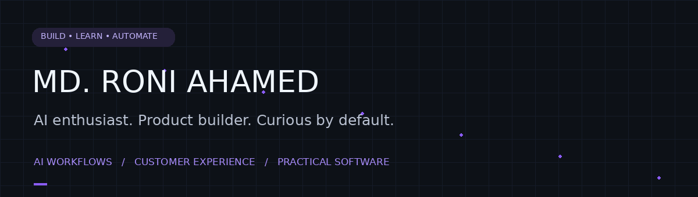
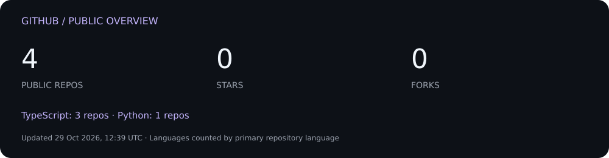

  <a href="#featured-projects">Projects</a> · <a href="#developer-dashboard">Dashboard</a> · <a href="#what-im-exploring">Exploring</a>

I’m **Roni**, an AI enthusiast and Computer Science student from Bangladesh. My customer experience background inspires me to build tools that make everyday work clearer, faster, and easier.

I’m interested in **AI agents, support automation, browser extensions, and useful SaaS products**.

## Featured projects

| Project | What it does | Explore |
| :--- | :--- | :--- |
| **✦ DraftPilot 2.0** | Customer-support drafting workspace with a dashboard, knowledge library, team tools, and a universal capture extension. Built and verified locally; staging integrations remain to be verified. | [Repository →](https://github.com/Sabbirshay/draftpilot2.0) |
| **◈ foodi Quiz Assistant** | Source-grounded employee quiz helper with explanations, exact excerpts, and an admin-managed knowledge publication workflow. | [Repository →](https://github.com/Sabbirshay/foodi-quiz-assistant) |
| **↗ DraftPilot — earlier version** | The earlier DraftPilot codebase, alongside the newer 2.0 workspace above. | [Repository →](https://github.com/Sabbirshay/draftpilot) |

## Developer dashboard

[Browse public repositories →](https://github.com/Sabbirshay?tab=repositories) · [View contribution activity →](https://github.com/Sabbirshay)

The dashboard uses public repository data only. Its timestamp shows the latest successful refresh.

## What I’m exploring

- **AI workflows:** turning repetitive work into useful, human-reviewed tools.
- **Product building:** dashboards, browser extensions, and customer-support software.
- **Foundations:** Computer Science, TypeScript, Python, and Linux.

Building useful things, one iteration at a time.

